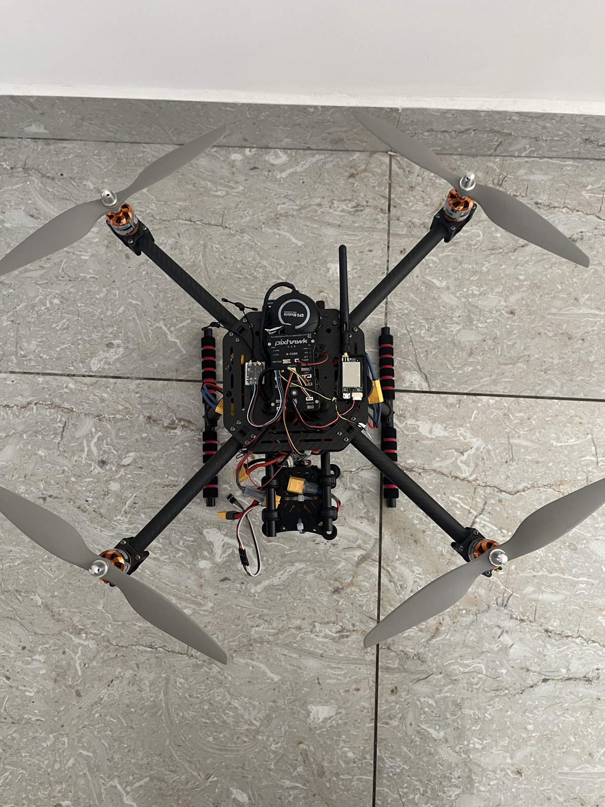

# Surveillance Drone

A carbon-fibre multirotor built for aerial observation, using a **Pixhawk 6C flight controller running PX4**. A **Skydroid camera and transmitter/receiver system** provided live video transmission from the drone.

## System overview

The airframe carries the flight electronics, propulsion system, battery and camera. PX4 runs on the Pixhawk 6C, while the Skydroid system provides the camera-to-ground video link for observation.

## Hardware

| Component | Details |
| --- | --- |
| Airframe | Carbon-fibre frame |
| Flight controller | Pixhawk 6C |
| Firmware | PX4 |
| Camera/video link | Skydroid camera with transmitter and receiver |
| Battery capacity | Approximately 6,200 mAh |
| Motor rating | Approximately 700 KV |
| Propellers | 1145 carbon-fibre propellers |

## Flight result

The recorded flight duration was recalled as approximately **18–19 minutes**, around **18 minutes 50 seconds**. This is an approximate reported test result; the flight log and exact test conditions are not included here.

Live video transmission was achieved using the Skydroid system. Video-link range, recording mode and battery voltage are not specified.

## Prototype view

