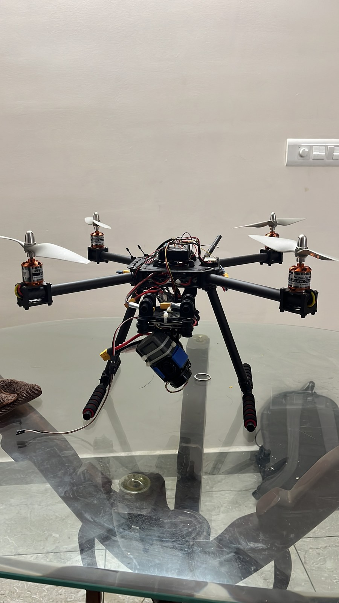

# Surveillance Drone

A multirotor prototype intended for aerial observation. The supplied photographs document its open-frame assembly, landing gear and electronics integration.

**Portfolio:** Thiruppathi P · [Thirusprojects](https://github.com/Thirusprojects)

## Project status

Two physical assembly photographs available. No camera feed or flight demonstration was supplied.

## Contribution

Personal responsibilities and team contribution are awaiting confirmation.

## Design and documented features

- Multirotor airframe with exposed electronics.
- Landing supports beneath the vehicle.
- Two views of the assembled prototype.

## Image gallery

- [Project image 1](media/images/bfc80873-1a85-4d8e-96ad-2a780f8a61f7.jpg)
- [Project image 2](media/images/img-3498.jpg)

## Evidence and limitations

The project title describes intended use. Camera model, video transmission, flight controller, firmware and demonstrated surveillance functions remain unconfirmed. No flight endurance or autonomous capability is claimed.

## Details to complete

Confirm your role, controller/firmware, camera and video link, and which flight or observation functions were demonstrated.

## File provenance

See [asset inventory](docs/ASSETS.md) for the mapping to supplied filenames. JPEG and MP4 exports are provided for browser access. Original presentation, PDF and CAD contents are retained where supplied.

This repository documents project materials supplied by the portfolio owner. Team work and third-party design contributions should be credited as their roles are confirmed.
